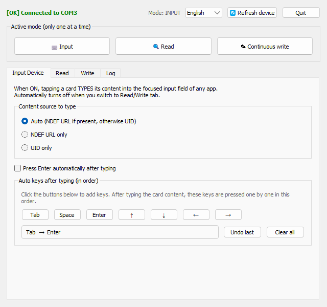
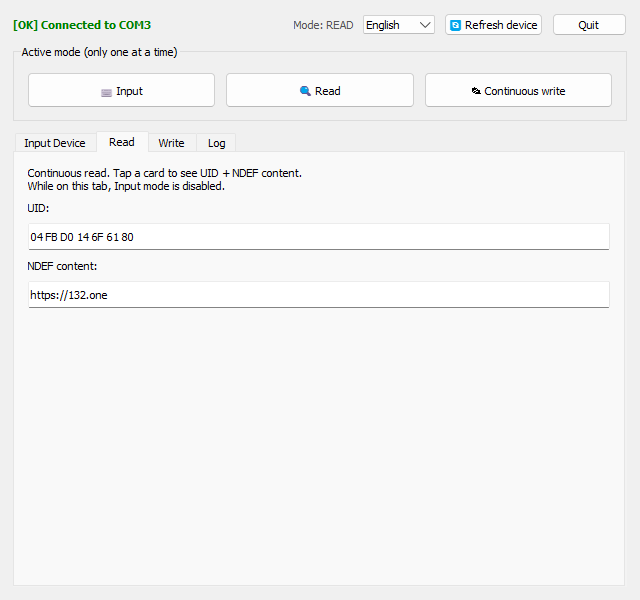
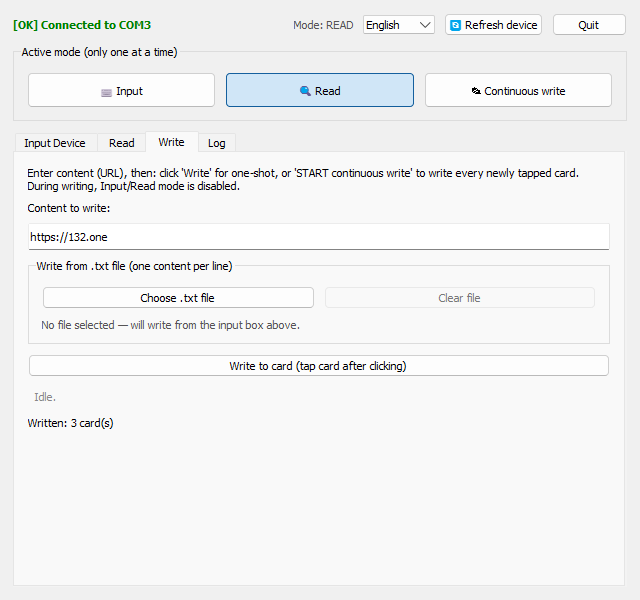
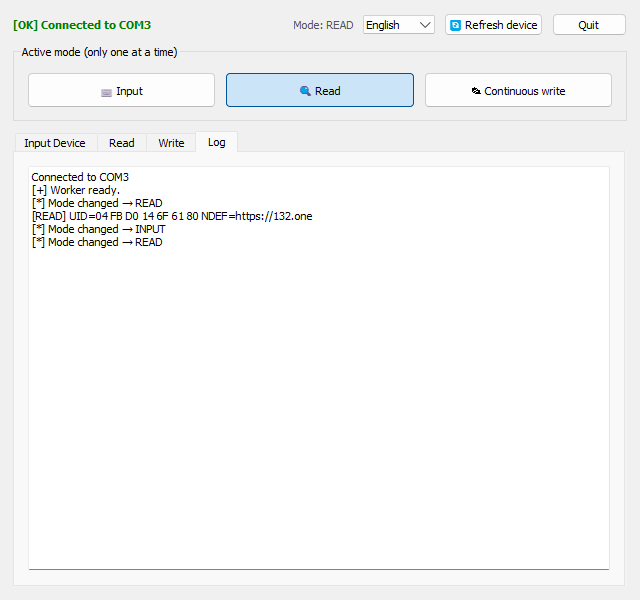

<p align="center">
  
</p>

# NFC Desktop App

*Read in other languages: [Tiếng Việt](README.md) · [日本語](README.ja.md)*

A **cross-platform (Windows / Linux / macOS)** desktop app for the
**NFC-PM5 reader (PN532 chip)** over a USB-Serial port.
It turns the NFC reader into an input device, reads/writes NTAG/Ultralight tags, runs in
the system tray, and supports 3 languages.

The entire source code lives in **a single file** `nfc_app.py` — you only need this file
plus the `lang/` folder (language JSON files) to run it.

## Device


**NFC-PM5** is a smart card (RFID/NFC) reader/writer that connects to a PC via **USB-Serial**:
- Controller chip **PN532**, Serial communication at 115200 baud.
- Two antenna areas: **IC READ WRITE** (13.56 MHz cards — MIFARE/NTAG/Ultralight) and
  **ID READ WRITE** (125 kHz cards).
- Usually ships with **RFID fobs** and **blank cards** for writing, plus a **USB cable**.
- On Windows it appears as a COM port (CH340/CP210x/FTDI driver...).

> This app works with **NTAG / MIFARE Ultralight** tags (13.56 MHz) in the
> *IC READ WRITE* area: it writes/reads content as NDEF URI. MIFARE Classic tags
> only expose their UID.

## Screenshots

| Input | Read |
|---|---|
|  |  |

| Write | Log |
|---|---|
|  |  |

## Features

### 3 operating modes (mutually exclusive — only one runs at a time)
- **Input** — turns NFC into an "input device": tapping a card *types* the card content
  (NDEF URL or UID) into the focused input field of **any application**
  (browser, Excel, Notepad...).
  - Content source: **Auto** (prefer NDEF URL, fall back to UID) / **NDEF URL only** / **UID only**.
  - **Auto keys after typing** (ordered, combinable): Tab, Space, Enter, ↑ ↓ ← →.
    Example: configure `Tab → Tab → Enter` to jump between fields and submit a form.
- **Read** — continuous reading, shows the UID and NDEF content of the tapped tag.
- **Continuous write** — writes to every newly tapped tag:
  - **From the input box**: writes the same content to each tag.
  - **From a .txt file**: each line is the content for one tag. Tapping a tag writes the
    current line then advances to the next; a **progress list** (✓ done / ▶ writing) is
    shown and it stops automatically when all lines are written.
  - A **Write once** button for a single tag.
  - Writes as **NDEF URI**, reads back to verify; shows the result + a counter of written tags.

### UI conveniences
- **Background (tray)**: minimizing or closing the window hides it to the system tray;
  the app keeps running. Right-click the tray icon to Show / Change language / Quit.
- **Change language from the UI** (combobox) or the tray menu — synced both ways.
  Supports: **Tiếng Việt / English / 日本語**. On first run it asks you to pick a language.
- **Device selection**: at startup, if multiple matching COM ports exist a picker dialog
  appears; if only one, it is used directly; if none, an error is shown.
- **🔄 Refresh device**: when the device is occasionally not detected, click to rescan & reconnect.
- **Quit button** right on the UI.
- **Log tab** shows activity logs (also localized).

## Requirements
- **Windows / Linux / macOS**
- Python 3.8+ (tested with Python 3.13)
- An **NFC-PM5 / PN532** reader over USB-Serial (CH340/CP210x/FTDI driver...)
- Libraries (see `requirements.txt`):
  - `PyQt5==5.15.11`
  - `pyserial==3.5`
  - Key typing for Input mode (auto-selected per platform):
    - Windows: `keyboard==0.13.5`
    - Linux / macOS: `pynput==1.7.7`

## Install
```bash
pip install -r requirements.txt
```
> `requirements.txt` uses *environment markers* to install `keyboard` only on Windows
> and `pynput` on Linux/macOS — the command above picks the right one for your platform.

## Run
```bash
python nfc_app.py
```
**Per platform:**
- **Windows**: the app **requires Administrator privileges** (requested via UAC) so the
  `keyboard` library can type into other apps; it also relaunches itself with
  `pythonw.exe` so **no console (cmd) window** appears.
- **Linux**: runs directly; the **Input** mode uses `pynput`, so you usually need to run
  it with `sudo python nfc_app.py` (keyboard simulation needs input access).
- **macOS**: runs directly; grant **Accessibility** permission to Terminal/Python
  (System Settings → Privacy & Security → Accessibility) to type into other apps.

**Device port names** differ by OS (the app auto-detects; shown for reference):
Windows `COM3`, Linux `/dev/ttyUSB0`, macOS `/dev/tty.usbserial-*`.

> Note: the `lang/` folder (containing `vi.json`, `en.json`, `ja.json`) must sit next to `nfc_app.py`.

## Build a standalone executable
Uses **PyInstaller** (the scripts auto-install it if missing):
- **Windows**: run `build.bat` → produces `dist\nfc_app.exe` (no console, with a manifest
  that requests Administrator rights via UAC, icon embedded from `icon.ico`) + `dist\lang\`.
- **Linux / macOS**: run `./build.sh` → produces `dist/nfc_app` + `dist/lang/`.

**App icon per platform:**
- **Windows**: `icon.ico` is embedded into the `.exe` (`--icon`).
- **macOS**: `icon.icns` is used for the `.app` bundle (`--icon`).
- **Linux**: ELF binaries can't embed an icon; the window/tray icon is loaded at
  runtime from `icon.png`. A `nfc_app.desktop` file is shipped so the app shows up in
  the launcher/dock (see the install hints printed by `build.sh`).

> **No cross-compilation**: PyInstaller only builds an executable for the OS it runs on.
> Build the Windows binary on Windows, the Linux binary on Linux, the macOS binary on macOS.
> To produce all three from one run, use CI/CD (e.g. GitHub Actions with a matrix of
> `windows-latest` / `ubuntu-latest` / `macos-latest`).
>
> Always keep the `lang/` folder next to the executable (the scripts copy it into `dist/`).

## Project structure
```
nfc_app.py            # The whole app (PN532 driver + GUI + i18n)
requirements.txt      # Pinned dependencies
icon.svg              # Source icon (vector)
icon.png              # 256px icon (window/tray; macOS build on PNG fallback)
icon.ico              # Multi-size icon for Windows (embedded in .exe)
icon.icns             # Icon for macOS (used by build.sh on macOS)
nfc_app.desktop       # Linux launcher entry (shows icon in menu/dock)
build.bat             # Build .exe on Windows (PyInstaller)
build.sh              # Build binary on Linux / macOS (PyInstaller)
README.md             # Docs (Tiếng Việt)
README.en.md          # Docs (English)
README.ja.md          # Docs (日本語)
lang/
  vi.json             # Vietnamese translation
  en.json             # English translation
  ja.json             # Japanese translation
screenshots/
  nfc_pm5.gif         # Device photo
  vi/ en/ ja/         # Screenshots per language
samples/
  inputs.txt          # Sample file for continuous write from file (one content per line)
nfc_app_config.json   # (auto-created) stores the chosen language
```

## Quick start
1. Plug the NFC-PM5 reader into your PC.
2. Run `python nfc_app.py`, accept UAC, pick a language (first run).
3. Pick a mode on the **Active mode** bar at the top — the matching tab opens automatically:
   - **Input**: place the cursor in a target field of another app → tap a card.
   - **Read**: tap a card to see the UID + NDEF.
   - **Continuous write**: enter content (or choose a .txt file) → tap each card to write.
4. Minimize to run in the background; reopen from the tray icon.

## Hardware & protocol
- Communicates with PN532 over Serial at 115200 baud, "Normal Frame".
- Tags supported for content read/write: **NTAG / MIFARE Ultralight** (write NDEF URI with
  command `0xA2`, read with `0x30`). MIFARE Classic tags only expose the UID.

## Technical notes
- All serial access is managed by **a single worker thread** → guarantees the 3 modes are
  mutually exclusive and never contend for the port.
- Fast polling (short timeout) keeps the loop responsive when a tag is tapped.
- Translations are separated into `lang/*.json`; adding/editing strings needs no code changes.
