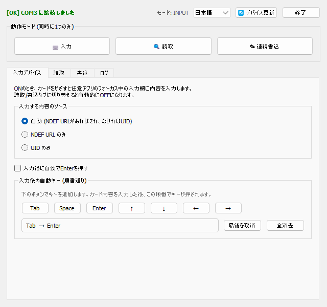
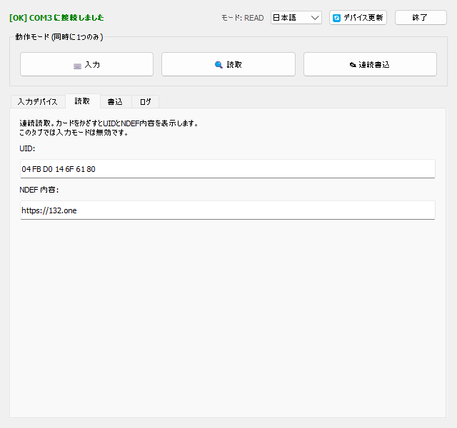
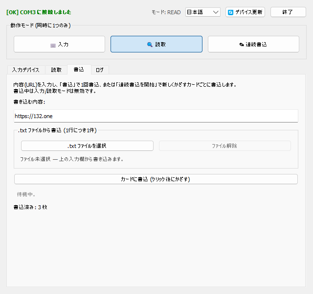
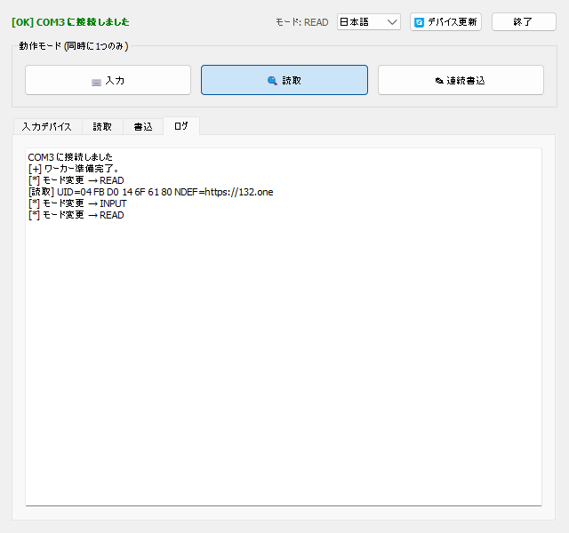

# NFC デスクトップアプリ

*他の言語で読む: [Tiếng Việt](README.md) · [English](README.en.md)*

USB-Serial 接続の **NFC-PM5 リーダー（PN532 チップ）** 用の
**クロスプラットフォーム（Windows / Linux / macOS）** デスクトップアプリです。
NFC リーダーを入力デバイスに変え、NTAG/Ultralight タグの読み書きを行い、システムトレイで
常駐し、3 言語に対応します。

ソースコードはすべて **1 つのファイル** `nfc_app.py` に収められています。このファイルと
`lang/`（言語 JSON ファイル）フォルダだけで動作します。

## デバイス


**NFC-PM5** は **USB-Serial** で PC に接続するスマートカード（RFID/NFC）リーダー/ライターです。
- コントローラチップ **PN532**、Serial 通信 115200 baud。
- 2 つのアンテナ領域: **IC READ WRITE**（13.56 MHz カード — MIFARE/NTAG/Ultralight）と
  **ID READ WRITE**（125 kHz カード）。
- 通常、書き込み用の **RFID フォブ** と **空白カード**、および **USB ケーブル** が付属します。
- Windows では COM ポートとして認識されます（CH340/CP210x/FTDI ドライバ...）。

> 本アプリは *IC READ WRITE* 領域の **NTAG / MIFARE Ultralight** タグ（13.56 MHz）を
> 対象とし、NDEF URI 形式で内容を読み書きします。MIFARE Classic タグは UID のみ読み取れます。

## スクリーンショット

| 入力 (Input) | 読取 (Read) |
|---|---|
|  |  |

| 書込 (Write) | ログ (Log) |
|---|---|
|  |  |

## 機能

### 3 つの動作モード（相互排他 — 同時に 1 つだけ）
- **入力 (Input)** — NFC を「入力デバイス」に変えます。カードをかざすと、その内容
  （NDEF 内の URL または UID）を **任意のアプリ**（ブラウザ、Excel、メモ帳...）の
  フォーカス中の入力欄に *入力* します。
  - 内容ソース: **自動**（NDEF URL を優先、なければ UID）/ **NDEF URL のみ** / **UID のみ**。
  - **入力後の自動キー**（順番付き・組み合わせ可能）: Tab, Space, Enter, ↑ ↓ ← →。
    例: `Tab → Tab → Enter` を設定して欄を移動しフォームを送信。
- **読取 (Read)** — 連続読取。かざしたタグの UID と NDEF 内容を表示します。
- **連続書込 (Write)** — 新しくかざすカードごとに書き込みます:
  - **入力欄から**: 各カードに同じ内容を書き込みます。
  - **.txt ファイルから**: 1 行が 1 枚分の内容。カードをかざすと現在の行を書き込み、
    次の行へ自動で進みます。**進捗リスト**（✓ 完了 / ▶ 書込中）が表示され、全行完了で自動停止。
  - **1 回書込** ボタンで 1 枚だけ書き込み。
  - **NDEF URI** 形式で書き込み、読み戻して検証。結果と書込枚数カウンタを表示します。

### UI の便利機能
- **バックグラウンド（トレイ）**: 最小化またはウィンドウを閉じるとトレイに格納され、
  アプリは動作し続けます。トレイアイコンを右クリックで 表示 / 言語変更 / 終了。
- **UI から言語変更**（コンボボックス）またはトレイメニューから — 双方向で同期。
  対応: **Tiếng Việt / English / 日本語**。初回起動時に言語を選択します。
- **デバイス選択**: 起動時、該当する COM ポートが複数あれば選択ダイアログを表示。
  1 つなら即使用、無ければエラー表示。
- **🔄 デバイス更新**: デバイスが時々認識されない場合、クリックで再スキャン＆再接続。
- **終了ボタン** を UI 上に配置。
- **ログタブ** で動作ログを表示（多言語対応）。

## 必要環境
- **Windows / Linux / macOS**
- Python 3.8+（Python 3.13 で検証済み）
- USB-Serial 経由の **NFC-PM5 / PN532** リーダー（CH340/CP210x/FTDI ドライバ...）
- ライブラリ（`requirements.txt` 参照）:
  - `PyQt5==5.15.11`
  - `pyserial==3.5`
  - 入力モードのキー入力（プラットフォームに応じて自動選択）:
    - Windows: `keyboard==0.13.5`
    - Linux / macOS: `pynput==1.7.7`

## インストール
```bash
pip install -r requirements.txt
```
> `requirements.txt` は *environment marker* を使い、Windows では `keyboard`、
> Linux/macOS では `pynput` のみをインストールします。上記コマンドで各環境に適したものが入ります。

## 実行
```bash
python nfc_app.py
```
**プラットフォーム別:**
- **Windows**: `keyboard` が他アプリへキー入力するため **管理者権限が必要**（UAC で要求）。
  また `pythonw.exe` で自身を再起動し、**コンソール（cmd）ウィンドウを表示しません**。
- **Linux**: そのまま実行。**入力**モードは `pynput` を使うため、通常は
  `sudo python nfc_app.py` で実行する必要があります（キーボード模擬には input アクセスが必要）。
- **macOS**: そのまま実行。他アプリへキー入力するには Terminal/Python に
  **アクセシビリティ**権限を付与してください（システム設定 → プライバシーとセキュリティ → アクセシビリティ）。

**デバイスのポート名** は OS により異なります（アプリが自動検出。参考）:
Windows `COM3`、Linux `/dev/ttyUSB0`、macOS `/dev/tty.usbserial-*`。

> 注意: `lang/`（`vi.json`、`en.json`、`ja.json` を含む）フォルダを `nfc_app.py` の隣に置いてください。

## 実行ファイルのビルド
**PyInstaller** を使用します（スクリプトが未インストールなら自動で入れます）:
- **Windows**: `build.bat` を実行 → `dist\nfc_app.exe`（コンソールなし、UAC で管理者権限を
  要求するマニフェスト付き、`icon.ico` を埋め込み）+ `dist\lang\` を生成。
- **Linux / macOS**: `./build.sh` を実行 → `dist/nfc_app` + `dist/lang/` を生成。

**プラットフォーム別アイコン:**
- **Windows**: `icon.ico` を `.exe` に埋め込み（`--icon`）。
- **macOS**: `icon.icns` を `.app` バンドルに使用（`--icon`）。
- **Linux**: ELF バイナリはアイコンを埋め込めないため、ウィンドウ/トレイのアイコンは
  実行時に `icon.png` から読み込みます。メニュー/Dock に表示するための
  `nfc_app.desktop` を同梱しています（`build.sh` が出力するインストール手順を参照）。

> **クロスコンパイル不可**: PyInstaller は実行中の OS 用の実行ファイルのみを作成します。
> Windows 版は Windows で、Linux 版は Linux で、macOS 版は macOS でビルドしてください。
> 1 回で 3 プラットフォーム分を作るには CI/CD（例: GitHub Actions の
> `windows-latest` / `ubuntu-latest` / `macos-latest` マトリクス）を使います。
>
> 実行ファイルの隣に必ず `lang/` フォルダを置いてください（スクリプトが `dist/` にコピーします）。

## プロジェクト構成
```
nfc_app.py            # アプリ全体（PN532 ドライバ + GUI + i18n）
requirements.txt      # 固定バージョンの依存関係
icon.svg              # ソースアイコン（ベクター）
icon.png              # 256px アイコン（ウィンドウ/トレイ、macOS ビルドの代替）
icon.ico              # Windows 用マルチサイズアイコン（.exe に埋め込み）
icon.icns             # macOS 用アイコン（macOS で build.sh が使用）
nfc_app.desktop       # Linux ランチャエントリ（メニュー/Dock にアイコン表示）
build.bat             # Windows で .exe をビルド（PyInstaller）
build.sh              # Linux / macOS でバイナリをビルド（PyInstaller）
README.md             # ドキュメント (Tiếng Việt)
README.en.md          # ドキュメント (English)
README.ja.md          # ドキュメント (日本語)
lang/
  vi.json             # ベトナム語翻訳
  en.json             # 英語翻訳
  ja.json             # 日本語翻訳
screenshots/
  nfc_pm5.gif         # デバイス写真
  vi/ en/ ja/         # 言語別スクリーンショット
samples/
  inputs.txt          # ファイルからの連続書込用サンプル（1 行 1 件）
nfc_app_config.json   # （自動生成）選択した言語を保存
```

## クイックスタート
1. NFC-PM5 リーダーを PC に接続します。
2. `python nfc_app.py` を実行し、UAC を許可、言語を選択（初回）。
3. 上部の **動作モード** バーでモードを選択 — 対応するタブが自動で開きます:
   - **入力**: 他アプリの対象欄にカーソルを置く → カードをかざす。
   - **読取**: カードをかざして UID + NDEF を確認。
   - **連続書込**: 内容を入力（または .txt ファイルを選択）→ 各カードをかざして書込。
4. 最小化してバックグラウンド動作。トレイアイコンから再表示。

## ハードウェア & プロトコル
- PN532 と Serial 115200 baud「Normal Frame」で通信。
- 内容の読み書きに対応するタグ: **NTAG / MIFARE Ultralight**（NDEF URI をコマンド `0xA2`
  で書込、`0x30` で読取）。MIFARE Classic タグは UID のみ。

## 技術メモ
- すべての Serial アクセスは **単一のワーカースレッド** が管理 → 3 モードの相互排他と
  ポート競合の回避を保証します。
- 高速ポーリング（短いタイムアウト）により、カードをかざした際の応答性を確保します。
- 翻訳は `lang/*.json` に分離。文字列の追加・編集にコード変更は不要です。
