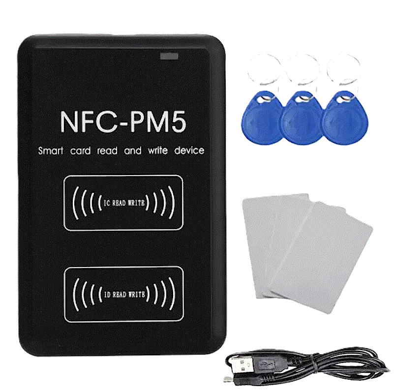
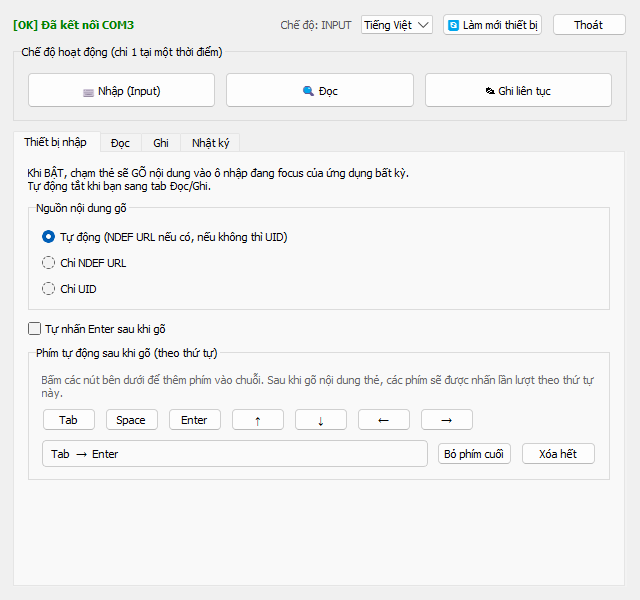
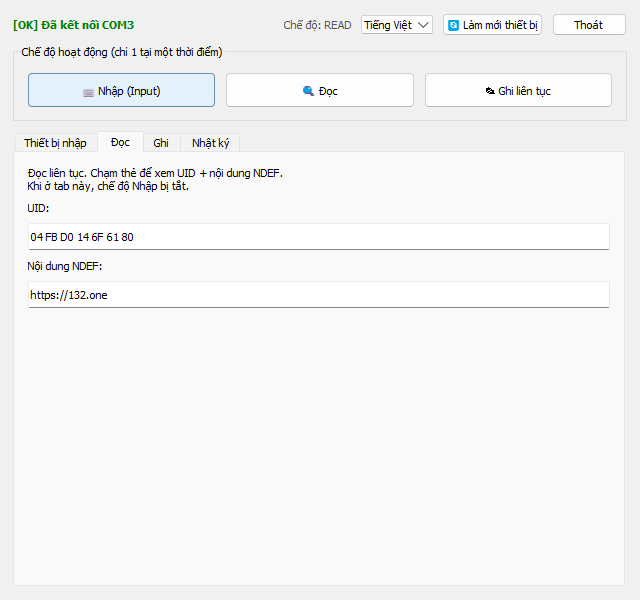
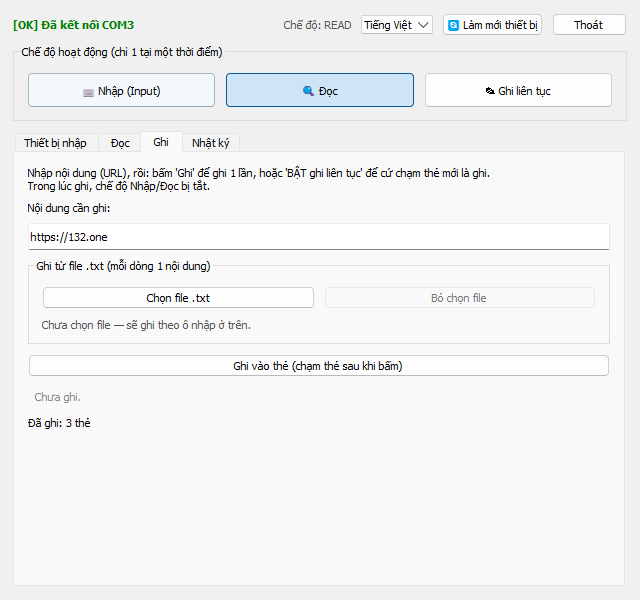
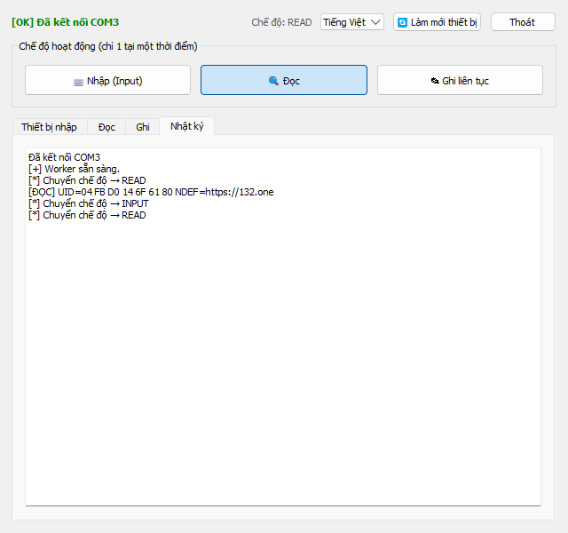

<p align="center">
  
</p>

# NFC Desktop App

*Đọc bằng ngôn ngữ khác: [English](README.en.md) · [日本語](README.ja.md)*

Ứng dụng desktop **đa nền tảng (Windows / Linux / macOS)** cho đầu đọc
**NFC-PM5 (chip PN532)** qua cổng USB-Serial.
Biến đầu đọc NFC thành thiết bị nhập liệu, đọc/ghi thẻ NTAG/Ultralight, chạy ngầm ở
khay hệ thống, hỗ trợ 3 ngôn ngữ.

Toàn bộ mã nguồn nằm trong **một file duy nhất** `nfc_app.py` — chỉ cần file này cùng
thư mục `lang/` (các file JSON ngôn ngữ) là chạy được.

## Thiết bị



**NFC-PM5** là đầu đọc/ghi thẻ thông minh (RFID/NFC) kết nối máy tính qua **USB-Serial**:
- Chip điều khiển **PN532**, giao tiếp Serial 115200 baud.
- Hai vùng ăng-ten: **IC READ WRITE** (thẻ 13.56 MHz — MIFARE/NTAG/Ultralight) và
  **ID READ WRITE** (thẻ 125 kHz).
- Thường bán kèm **fob RFID** và **thẻ trắng** để ghi, cùng **cáp USB**.
- Trên Windows nhận diện là một cổng COM (driver CH340/CP210x/FTDI...).

> Ứng dụng này làm việc với thẻ **NTAG / MIFARE Ultralight** (13.56 MHz) ở vùng
> *IC READ WRITE*: ghi/đọc nội dung theo chuẩn NDEF URI. Thẻ MIFARE Classic chỉ đọc được UID.

## Ảnh màn hình

| Nhập (Input) | Đọc (Read) |
|---|---|
|  |  |

| Ghi (Write) | Nhật ký (Log) |
|---|---|
|  |  |

## Tính năng

### 3 chế độ hoạt động (loại trừ nhau — chỉ 1 chế độ chạy tại một thời điểm)
- **Nhập (Input)** — biến NFC thành "thiết bị nhập": chạm thẻ sẽ *gõ* nội dung thẻ
  (URL trong NDEF hoặc UID) vào ô nhập đang focus của **bất kỳ ứng dụng nào**
  (trình duyệt, Excel, Notepad...).
  - Nguồn nội dung: **Tự động** (ưu tiên NDEF URL, không có thì UID) / **Chỉ NDEF URL** / **Chỉ UID**.
  - **Phím tự động sau khi gõ** (có thứ tự, kết hợp được): Tab, Space, Enter, ↑ ↓ ← →.
    Ví dụ: cấu hình `Tab → Tab → Enter` để tự nhảy ô và submit form.
- **Đọc (Read)** — đọc liên tục, hiển thị UID và nội dung NDEF của thẻ vừa chạm.
- **Ghi liên tục (Write)** — cứ chạm thẻ mới là ghi:
  - **Từ ô nhập**: ghi cùng một nội dung cho mỗi thẻ.
  - **Từ file .txt**: mỗi dòng là nội dung cho một thẻ. Chạm thẻ ghi dòng hiện tại rồi
    tự tiến sang dòng kế; có **bảng theo dõi tiến trình** (✓ đã ghi / ▶ đang ghi) và tự
    dừng khi hết dòng.
  - Nút **Ghi 1 lần** để ghi một thẻ duy nhất.
  - Ghi theo chuẩn **NDEF URI**, tự đọc lại để xác minh; hiển thị kết quả + bộ đếm số thẻ đã ghi.

### Tiện ích giao diện
- **Chạy ngầm (tray)**: thu nhỏ hoặc đóng cửa sổ → ẩn xuống khay hệ thống, app vẫn chạy.
  Chuột phải icon khay để Hiện cửa sổ / Đổi ngôn ngữ / Thoát.
- **Đổi ngôn ngữ ngay trên giao diện** (combobox) hoặc qua menu khay — đồng bộ 2 chiều.
  Hỗ trợ: **Tiếng Việt / English / 日本語**. Lần đầu chạy sẽ hỏi chọn ngôn ngữ.
- **Chọn thiết bị**: khi khởi động, nếu có nhiều cổng COM phù hợp sẽ hiện hộp thoại chọn;
  chỉ 1 thì dùng luôn; không có thì báo lỗi.
- **🔄 Làm mới thiết bị**: khi thỉnh thoảng không nhận được device, bấm để dò & kết nối lại.
- **Nút Thoát** ngay trên giao diện.
- **Tab Nhật ký** hiển thị log hoạt động (đã đa ngôn ngữ).

## Yêu cầu
- **Windows / Linux / macOS**
- Python 3.8+ (đã kiểm thử với Python 3.13)
- Đầu đọc **NFC-PM5 / PN532** qua USB-Serial (driver CH340/CP210x/FTDI...)
- Thư viện (xem `requirements.txt`):
  - `PyQt5==5.15.11`
  - `pyserial==3.5`
  - Gõ phím cho chế độ Nhập (tự chọn theo nền tảng):
    - Windows: `keyboard==0.13.5`
    - Linux / macOS: `pynput==1.7.7`

## Cài đặt
```bash
pip install -r requirements.txt
```
> `requirements.txt` dùng *environment marker* để chỉ cài `keyboard` trên Windows
> và `pynput` trên Linux/macOS — cứ chạy lệnh trên là đúng cho nền tảng của bạn.

## Chạy
```bash
python nfc_app.py
```
**Theo nền tảng:**
- **Windows**: app **yêu cầu quyền Administrator** (tự xin qua UAC) để thư viện
  `keyboard` gõ phím vào ứng dụng khác; app cũng tự khởi chạy lại bằng `pythonw.exe`
  để **không hiện cửa sổ console (cmd)**.
- **Linux**: chạy thẳng; chế độ **Nhập** dùng `pynput` nên thường cần chạy bằng
  `sudo python nfc_app.py` để mô phỏng bàn phím (quyền truy cập input).
- **macOS**: chạy thẳng; cần cấp quyền **Accessibility** cho Terminal/Python
  (System Settings → Privacy & Security → Accessibility) để gõ phím vào app khác.

**Tên cổng thiết bị** khác nhau theo HĐH (app tự dò, chỉ để tham khảo):
Windows `COM3`, Linux `/dev/ttyUSB0`, macOS `/dev/tty.usbserial-*`.

> Lưu ý: cần có thư mục `lang/` (chứa `vi.json`, `en.json`, `ja.json`) đặt cạnh `nfc_app.py`.

## Đóng gói thành file thực thi (build)
Dùng **PyInstaller** (script tự cài nếu thiếu):
- **Windows**: chạy `build.bat` → tạo `dist\nfc_app.exe` (không console, có manifest
  tự xin quyền Administrator qua UAC, nhúng icon từ `icon.ico`) + `dist\lang\`.
- **Linux / macOS**: chạy `./build.sh` → tạo `dist/nfc_app` + `dist/lang/`.

**Icon theo nền tảng:**
- **Windows**: `icon.ico` được nhúng vào `.exe` (`--icon`).
- **macOS**: `icon.icns` dùng cho `.app` bundle (`--icon`).
- **Linux**: binary ELF không nhúng được icon; icon cửa sổ/tray nạp lúc chạy từ
  `icon.png`. Kèm sẵn `nfc_app.desktop` để app hiện ở menu/dock (xem hướng dẫn cài
  mà `build.sh` in ra).

> **Không build chéo (cross-compile) được**: PyInstaller chỉ tạo file thực thi cho
> đúng hệ điều hành đang chạy. Muốn có bản Windows thì build trên Windows, bản Linux
> build trên Linux, bản macOS build trên macOS. Để ra cả 3 nền tảng từ một lần, dùng
> CI/CD (ví dụ GitHub Actions với matrix `windows-latest` / `ubuntu-latest` / `macos-latest`).
>
> Luôn giữ thư mục `lang/` cạnh file thực thi (script đã tự copy vào `dist/`).

## Cấu trúc dự án
```
nfc_app.py            # Toàn bộ ứng dụng (driver PN532 + GUI + i18n)
requirements.txt      # Phụ thuộc (phiên bản pin)
icon.svg              # Icon nguồn (vector)
icon.png              # Icon 256px (dùng cho cửa sổ/tray; macOS fallback khi build)
icon.ico              # Icon đa kích thước cho Windows (nhúng vào .exe)
icon.icns             # Icon cho macOS (build.sh dùng khi build trên macOS)
nfc_app.desktop       # Mục khởi chạy cho Linux (hiện icon ở menu/dock)
build.bat             # Script build .exe trên Windows (PyInstaller)
build.sh              # Script build binary trên Linux / macOS (PyInstaller)
README.md             # Tài liệu (Tiếng Việt)
README.en.md          # Tài liệu (English)
README.ja.md          # Tài liệu (日本語)
lang/
  vi.json             # Bản dịch Tiếng Việt
  en.json             # Bản dịch English
  ja.json             # Bản dịch 日本語
screenshots/
  nfc_pm5.gif         # Ảnh thiết bị
  vi/ en/ ja/         # Ảnh màn hình theo ngôn ngữ
samples/
  inputs.txt          # File mẫu cho ghi liên tục từ file (mỗi dòng 1 nội dung)
nfc_app_config.json   # (tự tạo) lưu ngôn ngữ đã chọn
```

## Hướng dẫn nhanh
1. Cắm đầu đọc NFC-PM5 vào máy.
2. Chạy `python nfc_app.py`, đồng ý UAC, chọn ngôn ngữ (lần đầu).
3. Chọn một chế độ trên thanh **Chế độ hoạt động** ở trên — tab tương ứng tự mở:
   - **Nhập**: đặt con trỏ vào ô cần điền ở ứng dụng khác → chạm thẻ.
   - **Đọc**: chạm thẻ để xem UID + NDEF.
   - **Ghi liên tục**: nhập nội dung (hoặc chọn file .txt) → chạm từng thẻ để ghi.
4. Thu nhỏ để chạy ngầm; mở lại từ icon khay hệ thống.

## Phần cứng & giao thức
- Giao tiếp PN532 qua Serial 115200 baud, khung "Normal Frame".
- Thẻ hỗ trợ ghi/đọc nội dung: **NTAG / MIFARE Ultralight** (ghi NDEF URI bằng lệnh
  `0xA2`, đọc bằng `0x30`). Thẻ MIFARE Classic chỉ đọc được UID.

## Ghi chú kỹ thuật
- Mọi truy cập cổng serial do **một luồng worker duy nhất** quản lý → đảm bảo 3 chế độ
  loại trừ nhau và không tranh chấp cổng.
- Dùng polling nhanh (timeout ngắn) để vòng lặp phản hồi kịp khi chạm thẻ.
- Bản dịch tách rời trong `lang/*.json`; thêm/sửa chuỗi không cần đụng mã nguồn.
